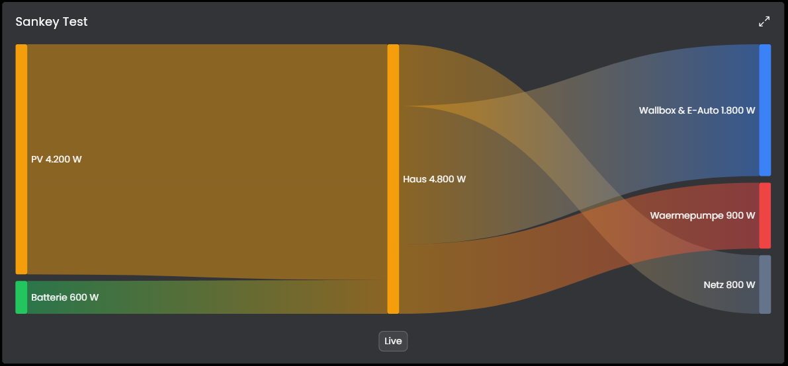

# Sankey
Dieses Modul stellt Energie- oder andere Flüsse als Sankey-Diagramm in der Kachel-Visualisierung von IP-Symcon dar.

## Inhaltsverzeichnis
- [Sankey](#sankey)
  - [Inhaltsverzeichnis](#inhaltsverzeichnis)
  - [Screenshots](#screenshots)
  - [1. Voraussetzungen](#1-voraussetzungen)
  - [2. Funktionsumfang](#2-funktionsumfang)
  - [3. Enthaltene Module](#3-enthaltene-module)
  - [4. Installation](#4-installation)
  - [5. Konfiguration in IP-Symcon](#5-konfiguration-in-ip-symcon)
  - [6. Spenden](#6-spenden)
  - [7. Lizenz](#7-lizenz)

## Screenshots

## 1. Voraussetzungen

* mindestens IPS Version 8.1
* Für das statische Diagramm: ein Archiv-Control mit protokollierten Variablen
* Die maximierte Ansicht der Kachel steht erst ab IPS 9.1 zur Verfügung

## 2. Funktionsumfang

* Darstellung beliebiger Flüsse zwischen Quellen und Zielen als Sankey-Diagramm
* Live-Ansicht: Das Diagramm aktualisiert sich, sobald sich eine verwendete Variable ändert
* Archiv-Ansicht: Werte eines frei wählbaren Zeitraums aus dem Archiv
* Anpassbare Farben und optionale Zusatzinfo je Fluss

Die einzelnen Funktionen stehen in der README des Moduls.

## 3. Enthaltene Module

* [Sankey](Sankey/README.md)
  * Zeigt das Sankey-Diagramm als Kachel an.
  * Live- und Archiv-Ansicht, umschaltbar in der Kachel.

## 4. Installation
Die Installation erfolgt über den IP-Symcon Module Store.

## 5. Konfiguration in IP-Symcon
Unter "Instanz hinzufügen" das Modul "Sankey" (Hersteller "Kai Schnittcher") anlegen und die Verbindungen konfigurieren. Details stehen in der [Modul-README](Sankey/README.md).

## 6. Spenden
Dieses Modul ist für die nicht kommerzielle Nutzung kostenlos, Schenkungen als Unterstützung für den Autor werden hier akzeptiert:

 

## 7. Lizenz

[CC BY-NC-SA 4.0](https://creativecommons.org/licenses/by-nc-sa/4.0/)
