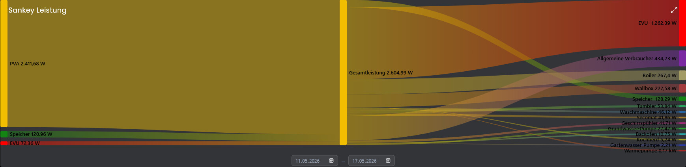

# Sankey
Dieses Modul stellt Flüsse (zum Beispiel Energieflüsse) als Sankey-Diagramm in der Kachel-Visualisierung dar. Die Instanz wird über "Instanz hinzufügen" unter dem Hersteller "Kai Schnittcher" angelegt. Das Diagramm läuft entweder live mit den aktuellen Variablenwerten oder zeigt aggregierte Werte eines Zeitraums aus dem Archiv.

## Inhaltsverzeichnis
- [Sankey](#sankey)
  - [Inhaltsverzeichnis](#inhaltsverzeichnis)
  - [1. Konfiguration](#1-konfiguration)
    - [Verbindungen](#verbindungen)
    - [Sonderfälle](#sonderfälle)
  - [2. Variablen](#2-variablen)
  - [3. Funktionen](#3-funktionen)
  - [4. Spenden](#4-spenden)
  - [5. Lizenz](#5-lizenz)

## 1. Konfiguration

Feld | Beschreibung
------------ | ----------------
Label-Farbe (Nodes) | Farbe der Beschriftung im Diagramm. "Transparent" (Standard) verwendet die Textfarbe der Visualisierung und passt sich dem hellen und dunklen Design an.
Werte an Nodes anzeigen | Zeigt die Werte zusätzlich an den Nodes an.
Statisches Diagramm (Werte aus Archiv) | Aktiviert die Archiv-Ansicht. In der Kachel kann dann der Zeitraum gewählt werden. Zählervariablen verwenden die Summe der Intervallwerte, alle anderen Variablen den Durchschnitt der Intervallwerte (positive und negative Werte getrennt). Ein Umschalter in der Kachel wechselt zwischen Live und Archiv.
Verbindungen | Hier wird das Diagramm konfiguriert.

### Verbindungen

Feld | Beschreibung
------------ | ----------------
Quelle (Von) | Knoten, an dem der Fluss beginnt.
Ziel (Nach) | Knoten, an dem der Fluss endet.
Variable (Wert) | Variable, aus der der Wert des Flusses gelesen wird.
Invertieren | Dreht die Flussrichtung um.
< 0 ignorieren | Negative Werte werden nicht dargestellt (siehe Sonderfälle).
Farbe (Quelle) | Farbe des Flusses beziehungsweise der Knoten.
Info (optional) | Variable, deren Wert als Zusatzinfo am Fluss angezeigt wird.

### Sonderfälle

**Statisches Diagramm, Standard-Aggregation, "< 0 ignorieren" nicht gesetzt**
Erzeuger und Verbraucher mit positiven und negativen Werten im Zeitraum stehen auf beiden Seiten des Diagramms.

Beispiel: EVU und Batterie stehen auf beiden Seiten. Der Speicher hat im Durchschnitt 120,96 Watt geliefert und wurde mit 128,29 Watt geladen. Der Versorger hat im Durchschnitt 72,36 Watt geliefert und 1262,39 Watt eingespeist.

Ist "< 0 ignorieren" gesetzt, werden die negativen Anteile nicht dargestellt.

**Live-Diagramm, "< 0 ignorieren" nicht gesetzt**
Der Eintrag wechselt die Seite, sobald sich das Vorzeichen ändert. Liefert eine Batterie Strom, steht sie links, wird sie geladen, steht sie auf der anderen Seite.

## 2. Variablen

Variable | Ident | Typ | Beschreibung
------------ | ------------ | ------------ | ----------------
Startdatum | `StartDate` | Ganzzahl (Datum/Uhrzeit, Unix-Zeitstempel) | Beginn des Zeitraums im statischen Modus. Nur im statischen Modus sichtbar und bedienbar.
Enddatum | `EndDate` | Ganzzahl (Datum/Uhrzeit, Unix-Zeitstempel) | Ende des Zeitraums im statischen Modus. Nur im statischen Modus sichtbar und bedienbar.

Die Variablen werden automatisch angelegt. Das Löschen kann zu Fehlfunktionen führen. Das Startdatum darf nicht nach dem Enddatum liegen.

## 3. Funktionen

`void SD_UpdateDiagram(integer $InstanzID);`
Erstellt das Diagramm neu. Wird automatisch aufgerufen, wenn sich eine verwendete Variable ändert (im statischen Modus nur, wenn der aktuelle Zeitpunkt im gewählten Zeitraum liegt).

## 4. Spenden
Dieses Modul ist für die nicht kommerzielle Nutzung kostenlos, Schenkungen als Unterstützung für den Autor werden hier akzeptiert:

 

## 5. Lizenz

[CC BY-NC-SA 4.0](https://creativecommons.org/licenses/by-nc-sa/4.0/)
